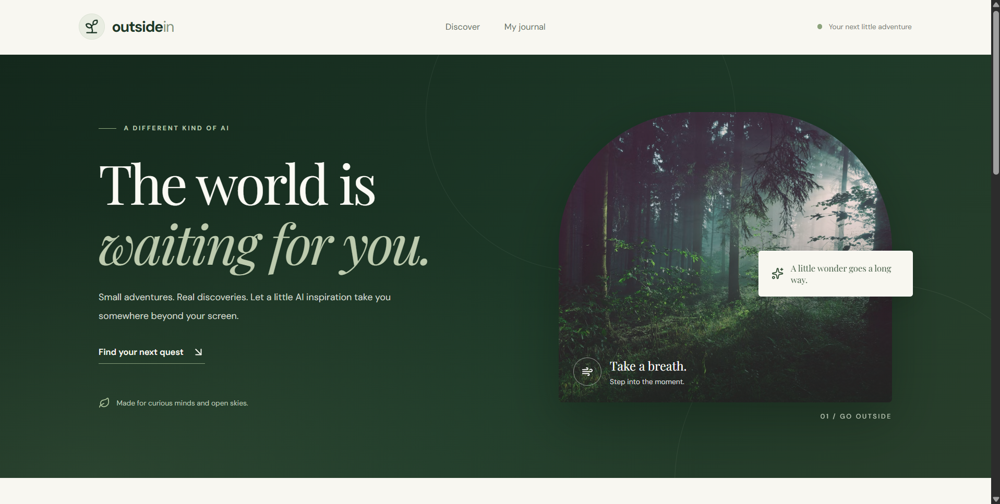
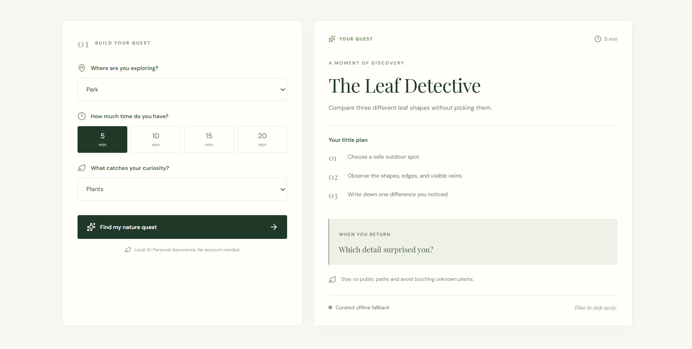
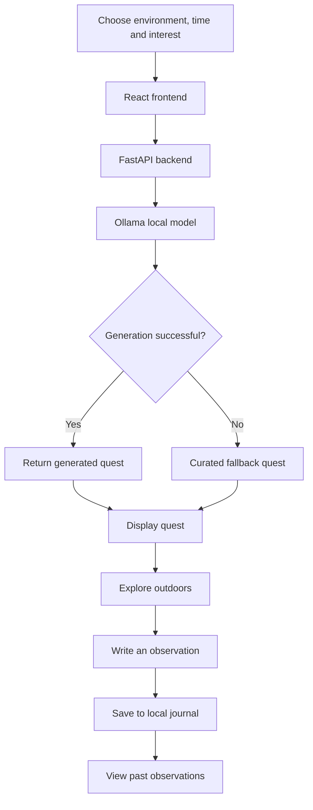

# OutsideIn — Find Your Wonder Beyond the Screen

**Small adventures. Real discoveries. A little AI inspiration to help you reconnect with the world outside.**

OutsideIn is a local-first AI-powered nature exploration companion that transforms ordinary moments outdoors into small, meaningful discoveries. Choose your surroundings, the time you have available, and what sparks your curiosity. OutsideIn creates a simple nature quest to help you slow down, observe your environment, and notice details you might otherwise overlook.

Built for the **Hacktoberfest 2026 Open-Source AI Challenge**, OutsideIn explores a simple idea: technology can be useful not only when we look at a screen, but also when it encourages us to step away from one.

> Your next little adventure starts outside.

---

## Table of Contents

- [Why OutsideIn?](#why-outsidein)
- [Screenshots](#screenshots)
- [Features](#features)
- [How It Works](#how-it-works)
- [Technology Stack](#technology-stack)
- [Project Architecture](#project-architecture)
- [Getting Started](#getting-started)
- [Running the Application](#running-the-application)
- [Local AI and Offline Fallback](#local-ai-and-offline-fallback)
- [API Reference](#api-reference)
- [Privacy and Safety](#privacy-and-safety)
- [Testing](#testing)
- [Environment and Configuration](#environment-and-configuration)
- [Project Roadmap](#project-roadmap)
- [Contributing](#contributing)
- [Acknowledgements](#acknowledgements)
- [License](#license)

---

## Why OutsideIn?

We spend much of our time looking at screens, even when the world around us is full of interesting details waiting to be noticed.

OutsideIn makes outdoor exploration feel approachable by turning it into a small, achievable activity rather than another task on a to-do list.

Whether you have five minutes between classes, a short break in a park, or time to explore your garden, OutsideIn helps you find something worth noticing.

### Our approach

- **Small adventures over big commitments:** Nature exploration can begin with just five minutes.
- **Curiosity over productivity:** The goal is to notice something, not to complete another performance metric.
- **AI as a guide, not a destination:** AI suggests activities that encourage real-world experiences.
- **Local-first by design:** The application is designed to keep personal observations on the user's own machine.
- **Technology with intention:** The best interaction may be the one that encourages you to put your device away.

---

## Screenshots

### 1. The OutsideIn homepage

The landing page introduces the OutsideIn experience with a forest-inspired hero, editorial typography, a nature photograph, and a clear invitation to discover something beyond the screen.



### 2. Build your nature quest

Choose an environment, select how much time you have, and tell OutsideIn what catches your curiosity. The interface adapts to a short break or a longer exploration session.


### 3. Your generated quest

Each quest presents a title, a short activity description, a sequence of practical steps, a reflection question, and a safety reminder. When local AI generation is unavailable, the application can use a curated fallback quest.



### 4. Your personal observation journal

Record what you noticed and revisit your small discoveries. The journal turns everyday observations into a growing collection of moments from the world outside.


---

## Features

### Nature quest generation

Create a personalised outdoor activity based on three preferences:

- **Environment:** Garden, college campus, park, or neighbourhood.
- **Available time:** Choose a short or longer exploration session.
- **Interest:** Explore plants, biodiversity, sounds, or observation and mindfulness.

The generated quest encourages curiosity through practical activities that can be completed in the real world.

### Structured, actionable missions

A quest can include:

- A descriptive mission title.
- A short introduction to the activity.
- A series of simple steps.
- A reflection question to consider after the activity.
- A safety reminder for responsible outdoor exploration.
- The duration and generation source.

### Personal observation journal

Write down what you discovered during an activity and save it locally. Previously saved observations can be retrieved and displayed in the journal.

### Local AI integration

OutsideIn integrates with Ollama to support locally hosted language models, including Gemma-compatible configurations. Local inference helps explore AI experiences without requiring a cloud AI API key.

### Curated fallback experience

If local model generation is unavailable, the application can fall back to curated activities so the core experience remains useful.

### Modern React interface

The frontend includes a nature-inspired visual identity, responsive layouts, interactive controls, loading states, error feedback, and a dedicated journal experience.

### Privacy-conscious design

Personal observations are stored locally by the application rather than requiring an account or a hosted journal service.

---

## How It Works

The experience follows a simple flow:

1. **Choose your surroundings.** Tell OutsideIn where you plan to explore.
2. **Set your time.** Pick a duration that fits your day.
3. **Follow your curiosity.** Select the subject you want to notice.
4. **Generate a quest.** The backend requests a mission from local AI or uses its fallback mechanism.
5. **Step outside.** Follow the suggested activity away from your screen.
6. **Reflect and record.** Save an observation to your personal journal.



---

## Technology Stack

| Component | Technology | Purpose |
|---|---|---|
| Frontend | React | Interactive user interface |
| Frontend tooling | Vite | Development server and build tooling |
| Icons | Lucide React | Consistent interface icons |
| API backend | FastAPI | REST endpoints and request validation |
| API server | Uvicorn | Runs the FastAPI application |
| AI inference | Ollama | Runs a language model locally |
| Language model | Gemma-compatible model | Generates nature quests |
| Data storage | JSON file | Stores personal observations locally |
| Testing | pytest | Python tests |
| Version control | Git and GitHub | Source control and collaboration |
| Automation | GitHub Actions | Automated checks in CI |

---

## Project Architecture

The project separates the frontend, API layer, and reusable application logic.

```text
OutsideIn/
├── .github/
│   ├── copilot-instructions.md
│   └── workflows/
│       └── tests.yml
├── docs/
│   └── screenshots/
│       ├── 01-homepage.png
│       ├── 02-quest-generation.png
│       ├── 03-generated-quest.png
│       └── 04-observation-journal.png
├── frontend/
│   ├── src/
│   │   ├── api.js
│   │   ├── App.jsx
│   │   ├── App.css
│   │   ├── index.css
│   │   └── main.jsx
│   ├── package.json
│   └── index.html
├── src/
│   └── outsidein.py
├── tests/
├── api.py
├── app.py
├── requirements.txt
├── .gitignore
└── README.md
```

**Main components**

- `frontend/src/App.jsx` — React interface, quest controls, loading and error states, and journal display.
- `frontend/src/api.js` — Functions for communicating with the backend.
- `api.py` — FastAPI application and REST endpoints.
- `src/outsidein.py` — Reusable quest-generation and observation-saving logic.
- `app.py` — Original Streamlit interface.
- `tests/` — Automated tests for application behaviour.

The Streamlit interface is retained as an alternative interface to the core functionality; the React frontend communicates with the FastAPI backend.

---

## Getting Started

### Prerequisites

Install the following before running the project:

- Python 3.10 or newer.
- Node.js and npm.
- Git.
- Ollama, if you want to use local AI generation.

A compatible local language model is required for AI generation through Ollama. The curated fallback may still provide quests when the model is unavailable.

### 1. Clone the repository

```bash
git clone https://github.com/Shreeja-88/outsidein.git
cd OutsideIn
```

Replace the placeholder URL with your actual GitHub repository URL. Use the repository's existing directory name if it differs from `OutsideIn`.

### 2. Create a Python virtual environment

**Windows PowerShell**

```powershell
python -m venv .venv
.\.venv\Scripts\Activate.ps1
```

If PowerShell blocks activation, you can invoke the environment's Python executable directly instead.

**macOS or Linux**

```bash
python3 -m venv .venv
source .venv/bin/activate
```

### 3. Install Python dependencies

```bash
python -m pip install --upgrade pip
pip install -r requirements.txt
```

### 4. Install frontend dependencies

Open a terminal in the project root:

```bash
cd frontend
npm install
```

Keep the frontend terminal open after starting the development server.

### 5. Set up Ollama

Install Ollama from its official website:

https://ollama.com/

Pull a Gemma model supported by your local Ollama installation. For example:

```bash
ollama pull gemma3:1b
```

The example model tag is configurable and must match the model name expected by your application. If your current implementation uses a different model, use that configured model instead.

Verify that Ollama is available:

```bash
ollama list
```

The model must be downloaded locally before it can be used for inference.

---

## Running the Application

Run each component in a separate terminal.

### Terminal 1: Start the FastAPI backend

From the project root, with the Python virtual environment activated:

```bash
python -m uvicorn api:app --reload --port 8000
```

The API will be available at:

- API base URL: `http://localhost:8000`
- Interactive API documentation: `http://localhost:8000/docs`
- Health check: `http://localhost:8000/api/health`

### Terminal 2: Start the React frontend

```bash
cd frontend
npm run dev
```

Open the local URL printed by Vite, typically:

`http://localhost:5173`

### Optional: Run the original Streamlit interface

If you want to run the original interface separately, open another terminal in the project root:

```bash
streamlit run app.py
```

Use the interface you want to test; the React frontend and Streamlit interface are separate entry points.

---

## Local AI and Offline Fallback

OutsideIn is designed to work with local AI inference through Ollama rather than depending exclusively on a hosted language model API.

The intended behaviour is:

1. The backend receives the user's quest preferences.
2. The application attempts to generate a quest using the configured local model.
3. If generation succeeds, the quest is returned to the frontend.
4. If generation is unavailable or fails, the fallback mechanism can provide a curated quest.

This approach supports experimentation with local AI while keeping the core nature-exploration experience useful when model generation is unavailable.

**Important distinction:** A local model is not automatically guaranteed to be available or successful. The model must be installed and running, and the application's configured model name and error-handling logic must be correct. Offline fallback availability depends on the implemented fallback code.

---

## API Reference

The React frontend communicates with the FastAPI backend through JSON REST endpoints.

Base URL: `http://localhost:8000/api`

### Health check

`GET /api/health`

Checks whether the backend is responding.

Example:

```bash
curl http://localhost:8000/api/health
```

### Generate a quest

`POST /api/quests`

Example request:

```json
{
  "environment": "Park",
  "minutes": 5,
  "interest": "Plants"
}
```

The endpoint returns the generated or fallback mission and its source.

Example response structure:

```json
{
  "mission": {
    "title": "The Leaf Detective"
  },
  "source": "fallback"
}
```

The response above illustrates the structure only; the actual mission object may contain additional fields and the source depends on the generation path.

### Save an observation

`POST /api/observations`

Example request:

```json
{
  "mission_title": "The Leaf Detective",
  "observation": "I noticed three different leaf shapes."
}
```

The endpoint saves the observation using the backend's configured journal storage.

### Retrieve observations

`GET /api/observations`

Returns the saved observations.

Example response structure:

```json
{
  "observations": []
}
```

The array contains saved records when observations are available.

For exact request models, response schemas, and interactive testing, visit:

`http://localhost:8000/docs`

---

## Privacy and Safety

OutsideIn is designed to encourage responsible, low-pressure exploration.

- **No account required:** The intended experience does not depend on a user account.
- **Local journal:** Observations are stored in local application storage rather than a hosted journal database.
- **Local inference:** Ollama can generate quests on the user's machine.
- **No unnecessary pressure:** Activities should be achievable and adaptable to the user's surroundings.
- **Outdoor safety:** Stay on public paths, respect private property and local rules, and avoid touching unfamiliar plants, animals, or fungi.
- **Personal judgement matters:** Skip any activity that feels unsafe or unsuitable for your environment.

Local storage is not the same as encryption. Anyone with access to the same computer and journal file may be able to read the saved observations. Local AI inference also does not eliminate every possible network interaction in the application.

---

## Testing

Python tests can be run from the project root:

```bash
python -m pytest -v
```

To check Python files for syntax or compilation errors:

```bash
python -m compileall -q app.py api.py src tests
```

If the frontend has a configured production build script, you can validate it with:

```bash
cd frontend
npm run build
```

The backend should be tested independently from the React interface. Where possible, unit tests should mock the Ollama interaction so that they do not require a running model or internet access.

Useful test cases include:

- Valid quest requests.
- Invalid request values.
- Successful quest generation.
- Model failures and fallback behaviour.
- Saving an observation.
- Retrieving saved observations.
- Handling a missing or malformed journal file.
- Frontend behaviour when the API is unavailable.

Only describe tests or CI checks as passing after they have actually been run successfully.

---

## Environment and Configuration

The application uses local services and configuration to generate quests and store observations.

Before sharing the repository:

- Verify that the Ollama URL and model name match your implementation.
- Keep personal journal data out of version control.
- Avoid committing secrets, credentials, local environment files, or private observations.
- Document any additional environment variables required by the current code.
- Keep Python and npm dependencies reproducible through their respective dependency files.

If your implementation uses a `.env` file, add it to `.gitignore` and provide a sanitised `.env.example` containing configuration names and safe example values only.

---

## Project Roadmap

Potential improvements for future development include:

- [ ] More diverse quests for different environments and interests.
- [ ] Better validation of AI-generated mission structures.
- [ ] More robust handling of Ollama errors and malformed responses.
- [ ] Improved journal search and filtering.
- [ ] Journal export and import.
- [ ] Expanded accessibility and mobile layouts.
- [ ] Automated backend and frontend checks through GitHub Actions.
- [ ] Additional curated quests for use when local AI is unavailable.
- [ ] Optional nature-observation categories and personal discovery collections.
- [ ] Documentation and beginner-friendly open-source contribution issues.

This roadmap represents potential future work, not a claim that every feature is already implemented.

---

## Contributing

Contributions, bug reports, and thoughtful ideas are welcome.

1. Fork the repository.
2. Create a branch for your change.
3. Make a focused improvement.
4. Run the relevant tests and checks.
5. Submit a pull request describing the change and how it was verified.

For feature proposals, explain the problem being solved and how the change supports OutsideIn's goal of encouraging meaningful real-world exploration.

Please avoid committing personal observation data, generated local files, credentials, or unnecessary dependencies.

---

## Acknowledgements

OutsideIn is built around the idea that small moments of curiosity can reconnect us with the world around us.

Thanks to the open-source ecosystem behind React, Vite, FastAPI, Ollama, and the tools that make local AI experimentation accessible.

Developed as part of the **Hacktoberfest 2026 Open-Source AI Challenge**.

---

## License
MIT License

---

**OutsideIn — Built for the moments beyond the screen.**

*Take a breath. Step outside. Notice something new.*
